  

  
  
  

Full Stack AI Engineer focused on applied AI (LLMs, RAG, MCP) and production web apps in React, Next.js, TypeScript, Python and C#.

I build design systems (500+ components, up to 70% less dev time) and agent tooling, and I am available for remote work from Brazil.

  

### Featured projects

**[Achilles](https://github.com/PedroReoli/Achilles-CDP-Agent)**  
MCP server that drives Chrome, Edge and Windows apps for AI agents.

**[Argos](https://github.com/PedroReoli/argos-action)**  
LoRA UI-action model (1.5B). Dataset and holdout eval on [Kaggle](https://www.kaggle.com/datasets/pedroreoli/argos-computer-use-mcp) (schema 121/132, action 56/132).

**Organon**  
Local-first desktop workspace for planning and documentation, with offline AI. Private for now.
