  

  
  
  

Full Stack AI Engineer com foco em IA aplicada (LLMs, RAG, MCP) e apps em produção com React, Next.js, TypeScript, Python e C#.

Eu construo design systems (500+ componentes, até 70% menos tempo de dev) e ferramentas para agentes, e estou disponível para trabalho remoto a partir do Brasil.

  

### Projetos em destaque

**[Achilles](https://github.com/PedroReoli/Achilles-CDP-Agent)**  
Servidor MCP que opera Chrome, Edge e apps Windows para agentes de IA.

**[Argos](https://github.com/PedroReoli/argos-action)**  
Modelo LoRA de ações de UI (1.5B). Dataset e eval holdout no [Kaggle](https://www.kaggle.com/datasets/pedroreoli/argos-computer-use-mcp) (schema 121/132, action 56/132).

**Organon**  
Workspace desktop local-first para planejamento e documentação, com IA offline. Por enquanto, privado.
